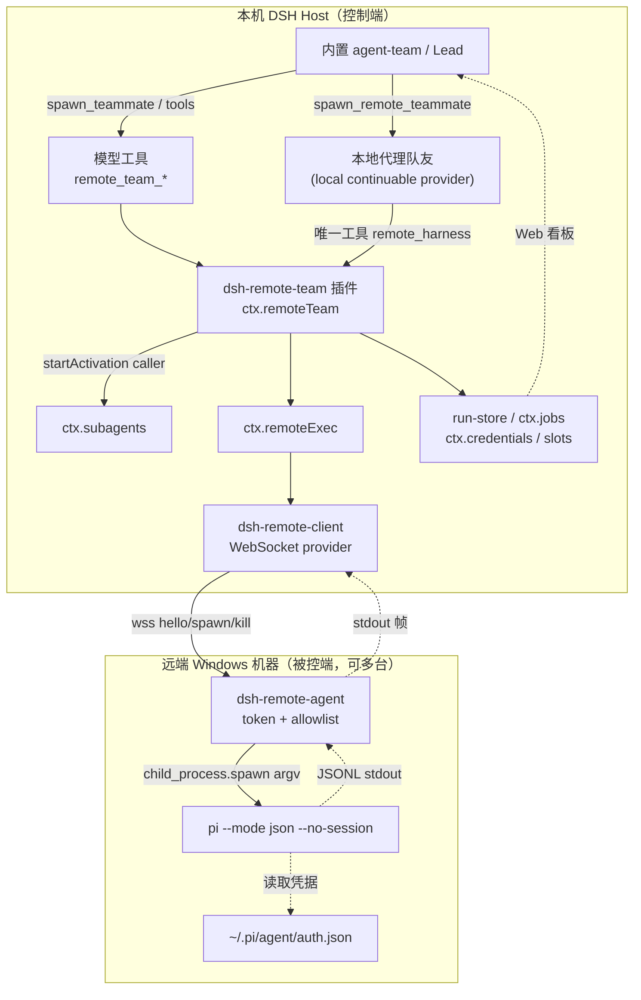

# DSH 远程智能体团队插件 · 实现方案

> 版本：v1.1（7 项决策已定，见 §13；待进入实施）
> 目标：开发一个 **DeepSeek Harness 第三方插件（bundle）**，用 DSH 内置的智能体团队（agent-team）调度其他电脑（主要为 Windows）上的 Harness（首个为 Pi coding agent）执行任务，并把结果回收到父 Session。
> 参考源码：`D:\code\github\deepseek-harness`、`D:\code\github\pi`
> 编写日期：2026-11-05

---

## 0. 先说结论（三句话）

1. **传输链路已经写好了，不要重做。** 当前分支 `feat/remote-harness-management` 上有一批未提交的新代码：`packages/remote/{remote, remote-agent, remote-client}` + `subagent-pi` 的 `mode: remote`，已实现「本机 DSH → WebSocket → Windows 常驻 agent → `pi --mode json` → JSONL 流回传」的完整 M1 链路，含 Windows `.cmd` shim 直解、`taskkill /T /F` 进程树回收、token 恒时比较、命令白名单、端到端测试。
2. **真正的缺口在「团队层」**：`spawn_teammate` 强制预留 `childId`，只接受实现了 `prepareContinuable()` 的本地 provider；远程 Pi 是一次性 external provider（只有 `start()`），**不能直接当 teammate**。仓库里 `.plans/remote-harness-management.md` 和 `subagent-pi/README.zh.md` 给出的 `freshProvider: pi-remote` 配置**运行时会失败**，是文档 bug。
3. **因此插件的定位是「组装 + 团队桥接 + 治理」**，而不是再造一条远程执行链路：以独立第三方 bundle 一次性装配已有能力，用「本地代理队友」把远程任务挂进 DSH 内置 agent-team，并补齐按次选 machine 的强能力调度、凭据、任务持久化、状态看板与安全边界。7 项决策已于 2026-11-05 全部确定（§13）；其中「原生远程 Provider」经代码核实为架构不可行，只能走代理队友（§4）。

---

## 1. 现状盘点（已逐文件核实）

### 1.1 已实现、可直接复用

| 能力 | 包 / 服务 | 关键位置 | 状态 |
|---|---|---|---|
| 远程执行 seam：`listMachines` / `probe` / `spawn` / `collect` / `registerProvider` | `ctx.remoteExec` | `packages/remote/remote/src/{index,types,error}.ts` | 分支新增，未提交 |
| 远端常驻进程：WS server、token、allowlist、`.cmd` shim 直解、连接关闭回收、`taskkill /T /F` | `dsh-remote-agent` | `packages/remote/remote-agent/src/{index,policy,bin}.ts` | 同上 |
| WS 客户端 provider：一机一连接、多 run 复用、请求关联、有界队列、失败归类 | name `websocket` | `packages/remote/remote-client/src/{index,connection,protocol}.ts` | 同上 |
| Pi 远程委派：只换 `PiChildSource`，`wire.ts` 协议解码零改动 | `subagent-pi` `mode: remote` | `packages/subagent/subagent-pi/src/{sources,child-source,run,index}.ts` | 同上 |
| 模型可见的 `subagent_pi` 工具 | `tool-subagent` | `packages/subagent/tool-subagent/` | 已有 |
| 子 agent 委派 seam、容量/深度限制（默认 8 / 1） | `ctx.subagents` | `packages/subagent/subagent/src/{index,types,manager}.ts` | 已有 |
| 内置团队：roster、peer 消息、任务 DAG/CAS、`wait_agent`、中断 | `ctx.agentTeams` + 9 个工具 | `packages/experimental/agent-team/`、`tool-agent-team/` | 已有（experimental） |
| 多机并行扇出脚本 | `ctx.workflowEngine` `parallel()` | `packages/workflow/workflow/` | 已有 |
| 后台任务状态机、进度、取消、事件 | `ctx.jobs` | `packages/jobs/jobs/` | 已有（进程内、不持久） |
| 凭据引用 / 人工授权流 | `ctx.credentials` / `ctx.authorization` | `packages/credentials/` | 已有 |
| 插件自定义 HTTP / WebSocket 端点 | `ctx.webServer.registerUpgrade()` | `packages/host/webserver/src/index.ts` | 已有 |
| 浏览器看板 slot / 类型化 Remote API | `ctx.slots` / `@Remote` | `packages/client/`、`packages/api/gateway/` | 已有 |

证据：`git status --short` 显示 `?? packages/remote/`、`?? packages/subagent/subagent-pi/src/{child-source,sources}.ts`、`?? docs/subsystems/remote.*`；分支 `feat/remote-harness-management`。四个新包的 `package.json` 已命名（`@deepseek-ai/dsh-remote`、`dsh-remote-agent`、`dsh-remote-client`，版本 `0.2.1-rc.5`）且已有 `lib/` 产物，但**尚未发布到 npm、也未装进 `packages/bundle/base/cordis.patch.yml`**。

### 1.2 三个必须知道的「反直觉」事实

| # | 事实 | 依据 |
|---|---|---|
| 1 | 远程 seam 叫 **`ctx.remoteExec`**，不是 `ctx.remote`。`ctx.remote` 是浏览器→Host 的 Typert RPC 服务；`ctx.remoteAccess` 是访问控制；`api/remotes` 是 BFF。多个 README 仍写 `ctx.remote` 属过时表述 | `packages/remote/remote/src/index.ts:42` `super(ctx, 'remoteExec')`；`docs/subsystems/remote.zh.md:136` |
| 2 | **agent-team 不能直接把远程 Pi 当队友**。`roster.spawn` 固定传 `childId` → `startActivation` 检查 `provider.prepareContinuable === undefined` 即抛 `UNSUPPORTED_CAPABILITY` | `packages/experimental/agent-team/src/roster.ts:242,264-267`；`packages/subagent/subagent/src/index.ts:269-273` |
| 3 | **Pi 没有任何网络监听入口**。`--mode rpc` 只有本地 stdio JSONL，官方 server/client/protocol 实验栈在 v1.2.0 已彻底删除且从未发布；`chord` 的 WebSocket 与 coding-agent 已解耦。所以「远程调度 Pi」只能靠外部网关或一次性进程 | `pi/packages/coding-agent/CHANGELOG.md`（v1.2.0 Removed）、`docs/rpc.md`、`src/modes/rpc/rpc-mode.ts` |

补充：`.plans/remote-harness-management.md` 第 3 行自称「方案草稿 / 未实现」，但计划里的阶段 0–3 已落地且比计划更完善（实际包名 `remote-agent` 而非 `remote-agent-win`，服务名 `remoteExec` 而非 `remote`；计划中的 `subprocess-remote` / `tool-remote-harness` 未做）。**该计划文档是滞后草稿，不能当作「尚未实现」的依据，但其中的风险表与 fork 取舍分析仍然有效。**

### 1.3 Pi 侧约束（决定被控端形态）

| 约束 | 影响 |
|---|---|
| `--mode json` / `--print` / `--mode rpc` 均不启 TUI，Windows 无 PTY 支持 | 被控端一律用非交互模式，不要跑 TUI |
| print/JSON/RPC 无法显示 project trust 提示 | 自动化必须显式 `--approve` 或 `--no-approve`，否则 `.pi/settings.json`、`.pi/extensions` 等受保护资源不加载 |
| Pi 无内建权限系统，以启动账户权限运行 | 远程下发任务 = 把被控机账户权限交给模型，必须外部设边界 |
| 凭据默认 `~/.pi/agent/auth.json`（被控机本地） | 模型凭据**必须留在被控机**，一机一 key；`scrubbedParentEnv()` 会剔除含 `KEY/TOKEN/SECRET/PASSWORD` 的变量，需要显式 `env` |
| 会话默认写被控机磁盘；`--no-session` 为内存临时会话 | 跨机续会话需自行同步或用 `get_entries(since)` 增量拉取 |
| 官方容器化 4 方案（Docker / Sandboxes / OpenShell / Gondolin）全部 Linux-centric | Windows 只能用低权限账户 + ACL + `--tools` 白名单 + `tool_call` 拦截扩展 |
| Windows 上不注册 `SIGHUP`；sshd 的 stdin EOF 不可靠 | 关闭/取消走显式 `abort` / `dispose()` / `taskkill`，不要依赖关 stdin |
| Node ≥ 22.19、需 Git Bash | 被控端安装前置 |

---

## 2. 插件定位与边界

### 2.1 做什么

一个**独立可分发的 npm 组合包**（`dsh.bundle.patch`），安装到 profile 后：

- 一次性装配 `dsh-remote` / `dsh-remote-client` / 每台机器一个 `dsh-subagent-pi` 实例，把「装好就能用」从 4 段手工 YAML 变成一次 `dsh plugin add`。
- 提供 `ctx.remoteTeam` 服务：机器清单与能力探测、按机器派发、多机并行、任务生命周期与持久化、并发闸门与策略。
- 提供一组模型可见工具，让 Lead 能列机器、探活、派任务、查进度、取消、取回结果。
- 提供「本地代理队友」，让内置 agent-team 的 roster / 任务板 / `send_message` / `wait_agent` 语义完整覆盖远程任务。
- 提供 Web 看板（机器状态 + 在跑任务）。

### 2.2 不做什么

| 不做 | 原因 |
|---|---|
| 重写 WebSocket 传输 / 远端 agent / Pi JSONL 解码 | 已有且带测试，重复造轮子 |
| 改 `packages/experimental/agent-team` 核心 | 第三方插件不能侵入主干；用代理队友绕开 |
| 远程文件系统双向同步 / 产物回传 | `remote/*` 明确只回传 stdout/stderr，首版让 Pi 把结果写进回答 |
| 远程 fork（继承 Lead 历史） | Pi 是 out-of-process，无 `prepareContinuable`；首版保留本地 `fork` |
| 自动重放 / 断线续跑 | `OUTCOME_UNKNOWN` 时明确报「结果未知」，不做可能重复的自动重试 |
| 远端 Windows 沙箱隔离 | 靠 OS 层（低权限账户 + ACL + 防火墙）+ 扩展层工具白名单 |
| 反向连 / NAT 穿透 provider | 远端已确认可监听端口（决策 #6），现有 `remote-client` 主动连出即可，不需要 `ctx.webServer.registerUpgrade()` |
| 改上游 `remote-agent` 加内置 TLS | 决策 #7：插件自带 wss 终结层，不 fork 上游包 |
| 非 Pi harness 的完整实现 | 只留 `HarnessAdapter` 接口与 ACP/MCP 扩展位 |

### 2.3 前置依赖（必须先落地，否则插件装不上）

四个 `@deepseek-ai/dsh-remote*` 包与 `dsh-subagent-pi` 的 remote 改动仍在本地分支、未发布。三选一：

| 方案 | 做法 | 建议 |
|---|---|---|
| A. 本地 link（开发期） | 在测试 profile 里 `dsh plugin --profile <p> add D:/code/github/deepseek-harness/packages/remote/remote` 等 4 个目录，pnpm 以 `link:` 方式挂入 | ✅ 首版用这个 |
| B. 打包 tarball | `pnpm pack` 四个包 → `dsh plugin add ./xxx.tgz`，随插件一起分发 | 交付期 |
| C. 等上游合并发布 | 依赖 DSH 主干合并 `feat/remote-harness-management` 并合入 base bundle | 长期 |

> 插件 `package.json` 里应把这 4 个包写成 `peerDependencies`（版本 `^0.2.1-rc.5`），避免第三方包把它们重复打进自己的 `node_modules`。

---

## 3. 总体架构



**数据流（一次派发）**：Lead 或代理队友调用工具 → `ctx.remoteTeam.dispatch()` 选机器 + 映射 cwd → `ctx.subagents.startActivation({ provider: 'pi@<machine>', delivery: 'caller', request: { prompt, cwd: <远端绝对路径>, signal } })` → `RemotePiChildSource` → `ctx.remoteExec.spawn()` → WS `spawn` 帧 → 远端 `pi --mode json --no-session -- <task>` → stdout JSONL 帧回流 → `PiRecordDecoder` → `SubagentResult` → 写入 run-store / 更新 job 进度 → 结果回到 Lead（代理队友则作为自己的最终回答，由 team 正常回流）。

---

## 4. 核心设计决策：如何让「内置团队」管远程 Harness

| 路线 | 做法 | 优点 | 缺点 | 结论 |
|---|---|---|---|---|
| **A. 直接把 `freshProvider` 指向远程 Pi** | 只改 `tool-agent-team` 配置 | 零代码 | **运行时必失败**：`roster.spawn` 传 `childId`，Pi 无 `prepareContinuable` → `UNSUPPORTED_CAPABILITY` | ❌ 排除（现有文档示例有误） |
| **B. 插件注册一个实现 `prepareContinuable()` 的远程 Provider** | 本地建子 Session 作 roster 成员，实际执行交给远程 | 看起来最原生 | **架构上不可行**：`prepareContinuable()` 只返回 `{ seed? }`，是 provider 对 continuable child 的唯一参与；manager 独占 Agent 创建、prompt 投递、冷恢复与销毁，provider 永远看不到 child 的 Agent / 轮次 / teardown；`materialize({ kind: 'local' })` 固定创建本地 in-process Agent | ❌ 排除 |
| **C. 只做 `remote_team_*` 工具集，绕过 team** | Lead 直接调工具 + `workflowEngine.parallel()` 多机扇出 | 最简单可靠，天然支持多机 | 严格说不算「用内置团队管理」，缺 roster/任务板/消息语义 | ✅ **阶段 1（MVP）** |
| **D. 本地代理队友（Proxy Teammate）** | roster 仍用本地 `spawn`/`fork` provider；插件给该队友注入 preset + 收缩工具集，使它只能调用 `remote_harness` 工具，把远程结果作为自己的回答 | 零侵入 agent-team 核心；roster / 任务板 / `send_message` / `wait_agent` / 中断 / 持久成员全部照常；天然支持 `spawn_remote_teammate({machine})`；**队友可多轮追问，正是「更强能力」的来源** | 每个远程任务多一层本地 DSH agent 中转（额外 token）；本地队友与远程 run 的生命周期需要显式对齐 | ✅ **阶段 2（最终形态，决策 #3 已定）** |

**决策已定：C 打底 + D 收口（用户 2026-11-05 确认）。** `remote_team_run` 是唯一执行入口，代理队友只是把它包一层；这样即使不用团队，Lead 也能直接派发，团队接入后不会有两套执行路径。

> **为什么 B 不是「工程量大」而是「不可能」**（`packages/subagent/subagent/src/types.ts:341-355` 原文）：
> "This is the provider's ONLY participation in a continuable child. The continuation manager owns identity reservation, composition, **Agent creation**, prompt delivery, cold resume, ownership, and disposal, so **a provider never sees the child's Agent, handle, turns, or teardown**."
> `ContinuableCreateSpec` 只有一个字段 `seed?: readonly SessionEvent[]`（`types.ts:218-225`），`manager.startLocal()` 用 `materialize({ kind: 'local', ... })` 建本地 Agent（`manager.ts:437-455`）。也就是说，**凡是进入 agent-team roster 的成员，执行引擎必然是本地 DSH Agent**。
>
> 这反而印证了「代理队友」不是妥协，而是 DSH 架构下接入远程执行的**唯一正确抽象**：本地活 Agent 承载团队语义（roster / 任务板 / `send_message` / steer / 中断 / 持久身份），远程 Pi 通过工具承载一次性执行。用户要求的「更强能力」恰好全部由这个本地 Agent 保留——远程一次性进程做不到多轮，但队友可以。若将来确实要去掉这层中转，唯一路径是改 DSH 内核的 continuation manager（与「独立第三方 bundle、不侵入主干」冲突），不在本方案范围。

代理队友的实现要点：

- 用 `ctx.agentTeams.spawnTeammate(agent, { name, description, prompt, context: 'fresh', provider: 'spawn' })`，provider 保持本地，满足 `childId` 约束。
- 通过 `agentPreset` 或 `ctx.systemPrompt` 注入 persona：「你是远程机器 `<machine>` 上的执行代理；只能用 `remote_harness` 工具提交任务；把工具返回的结果原样作为最终回答；不要在本机做任何文件操作」。
- 用 `ctx.tools.restrict()` 对该子 agent 隐藏其他工具（DSH 支持按 agent 作用域收缩工具集）。
- 子 agent 结束回合 → 完成通知按 `delivery: 'parent'` 语义回到 Lead，team 的 `wait_agent` 正常解除阻塞。
- 取消/超时：Lead Interrupt → 子 agent `signal` 中止 → 插件在 `dispose` 里调 `RemoteRun.dispose()` → 远端 kill 进程树。

---

## 5. 插件结构与清单

### 5.1 目录（放在本工作区 `D:/code/workbuddy-projects/ai-teams/`）

```
dsh-remote-team/
  package.json                  # dsh.bundle.patch / exports / locale / icon / engines.dsh
  cordis.patch.yml              # 一次插入全部 Host 行
  index.js                      # Host 入口：named export apply / inject / Config（纯 ESM，无构建）
  client.js                     # Web 入口：window.__ModuleLoader__.load factory + slots
  locale/{en,zh}.json           # meta.title / meta.description
  icon.svg
  src/
    service.js                  # RemoteTeamService extends Service → ctx.remoteTeam
    registry.js                 # 机器清单映射、capabilities、cwdMap、并发计数
    dispatch.js                 # 选机器 / startActivation / parallel 扇出 / 取消
    run-store.js                # $DSH_HOME/remote-team/runs.jsonl 持久记录
    progress.js                 # Pi JSONL 事件 → job.updateProgress / 结构化日志
    policy.js                   # 命令白名单二次校验、机器级并发闸门、审批 hook
    credentials.js              # token 经 ctx.credentials.resolve() 注入配置
    proxy-teammate.js           # spawn_remote_teammate + preset + tools.restrict
    tools.js                    # 全部 defineTool 定义
    adapters/
      harness-adapter.js        # 接口：buildArgv / decode / cancel / probe
      pi.js                     # 首个实现（复用 subagent-pi，本插件只做配置与映射）
  presets/remote-worker.md      # 代理队友 persona
  remote-agent/
    wss-proxy.js                # 插件内置 TLS 终结：https :8787 → ws://127.0.0.1:8788
    install.ps1                 # 生成 CA/一机一证书/token、两个计划任务、防火墙、专用账户
    tls.md                      # 证书轮换、NODE_EXTRA_CA_CERTS、Tailscale 开发期通道
  tests/                        # 单测 + 用 fake-pi 的 Loader 组合 e2e
  README.md / README.zh.md      # 部署、安全边界、故障排查
```

> 首版用**纯 ESM JavaScript**，不引入 TS/tsdown 构建链（DSH 官方 `templates/decoration/` 就是纯 JS）。等接口稳定后再上 TypeScript + `tsconfig.host.json` / `tsconfig.client.json` 双 aggregate。

### 5.2 `package.json`（关键字段）

```json
{
  "name": "dsh-remote-team",
  "version": "0.1.0",
  "type": "module",
  "exports": {
    ".": "./index.js",
    "./client": "./client.js",
    "./locale/*.json": "./locale/*.json",
    "./icon": "./icon.svg",
    "./package.json": "./package.json"
  },
  "files": ["index.js", "client.js", "cordis.patch.yml", "src/", "presets/", "locale/", "icon.svg"],
  "dsh": {
    "manifestVersion": 1,
    "bundle": { "patch": "./cordis.patch.yml" },
    "client": { "platform": "web" }
  },
  "engines": { "node": ">=24", "dsh": ">=0.2.1-rc.5" },
  "peerDependencies": {
    "@deepseek-ai/cordis": "*",
    "@deepseek-ai/dsh-remote": "^0.2.1-rc.5",
    "@deepseek-ai/dsh-remote-client": "^0.2.1-rc.5",
    "@deepseek-ai/dsh-subagent-pi": "^0.2.1-rc.5",
    "@deepseek-ai/dsh-subagent": "*"
  }
}
```

注意 DSH 的约定：**没有 `dsh/plugin` 字段、没有 `contributes` 清单、没有 `activate/deactivate` 钩子**；贡献都是运行时通过 `ctx.effect()` / `ctx.on()` / `register()` 注册的可逆副作用。第三方插件也**不得新增 `SessionEventMap` 事件类型**、不得调用 `appendPluginRecord()`。

### 5.3 `cordis.patch.yml`（一次装配，示意）

```yaml
- insert:
    # 1) seam 必须先于 provider 可用
    - id: remote
      name: '@deepseek-ai/dsh-remote'

    # 2) 每台机器一条配置；token 不落盘，走环境变量 / ctx.credentials
    #    url 必须是 wss://（插件启动校验）；控制端启动前设 NODE_EXTRA_CA_CERTS 指向自签 CA
    - id: remote-client
      name: '@deepseek-ai/dsh-remote-client'
      config:
        machines:
          - id: dev-win
            name: '开发机 Windows'
            url: 'wss://192.168.1.20:8787'
            token: '${REMOTE_AGENT_TOKEN_DEV_WIN}'
          - id: build-win
            name: '构建机 Windows'
            url: 'wss://192.168.1.21:8787'
            token: '${REMOTE_AGENT_TOKEN_BUILD_WIN}'

    # 3) 每台机器一个唯一的 Pi provider 实例
    - id: subagent-pi-dev-win
      name: '@deepseek-ai/dsh-subagent-pi'
      config:
        providerName: 'pi@dev-win'
        mode: remote
        machine: dev-win
        command: pi
        args: ['--model', 'sonnet', '--approve']
    - id: subagent-pi-build-win
      name: '@deepseek-ai/dsh-subagent-pi'
      config:
        providerName: 'pi@build-win'
        mode: remote
        machine: build-win
        command: pi
        args: ['--model', 'sonnet', '--approve']

    # 4) 插件本体
    - id: remote-team
      name: 'dsh-remote-team'
      config:
        machines:
          - id: dev-win
            provider: 'pi@dev-win'
            cwd: 'D:\work\repo'          # 远端绝对路径
            maxConcurrentRuns: 2
            tags: ['dev', 'windows']
          - id: build-win
            provider: 'pi@build-win'
            cwd: 'D:\build\repo'
            maxConcurrentRuns: 1
            tags: ['build', 'windows']
```

**三个易踩的点**：

1. `--approve` 必须显式加到 `args`（放在 `--mode json --no-session` 之前），否则 Pi 在非交互模式下会跳过受保护的项目资源。
2. `subagent-pi` 的 `request.cwd` 默认继承**父 Session 的本地工作目录**，remote 模式只做非空校验就直接当远端路径用；远端不存在该目录会被 `decidePolicy` 以 `cwd-missing` 拒绝。插件必须在 `startActivation` 的 `request.cwd` 里显式传 `machines[].cwd`（`SubagentStartRequest.cwd?` 支持覆盖，见 `subagent/src/types.ts:136-138`）。
3. `subagent-pi` 的 `capabilities = NO_START_CAPABILITIES`，不接受 `agentPreset` / `agentOptions` / `outputSchema` / `maxDepth`。代理队友的 preset 只能作用于**本地 DSH 子会话**，不能透传给远程 Pi。

---

## 6. 模型可见工具（API）

| 工具 | 参数 | 返回 | 说明 |
|---|---|---|---|
| `remote_team_list` | — | 机器清单：id / status / platform / tags / capabilities / 运行中数 / 并发余量 | 只读，包一层 `ctx.remoteExec.listMachines()` + registry 画像 |
| `remote_team_probe` | `machine?` | 在线状态、Pi 版本、allowlist 是否放行 `pi`、cwd 可用性、TLS 校验结果 | 探活 + 一次轻量 Pi 版本探测；结果缓存短 TTL，画像变化时主动刷新 |
| `remote_team_route` | `task?`, `tags?`, `prefer?` | 推荐机器 id + 打分依据 | 模型可先问「这活该给谁」再派；不给 machine 时 `remote_team_run` 内部自动调用 |
| `remote_team_run` | **`machine?`**, `task`, `cwd?`, `wait?`, `timeoutMs?`, `tags?` | `runId` + 状态 + 实际选中的机器；`wait=true` 时同步给 `SubagentResult` | **唯一执行入口**。machine 显式指定则直接用；省略则按 §6.1 打分自动路由。模型按次选机器即由此实现 |
| `remote_team_parallel` | `tasks: [{machine?, task, cwd?, tags?}]`, `failFast?`, `concurrency?` | 每项结果 + 汇总 + 每台机器的耗时/失败 | `ctx.workflowEngine.parallel()` 或并发 `startActivation({delivery:'caller'})`；受 `maxActiveSubagents=8` 与机器级闸门双重限制 |
| `remote_team_status` | `runId` | 状态机当前态、进度行、已产出字节、远端 run id、所在机器 | 断线时明确返回 `outcome: unknown` |
| `remote_team_output` | `runId`, `cursor?` | 增量输出 / 最终文本 | 消费 `ctx.jobs.readAt()` 游标 |
| `remote_team_cancel` | `runId` | 取消结果 | `RemoteRun.dispose()` → 远端 `kill` + taskkill 兜底 |
| `spawn_remote_teammate` | `name`, `description`, `prompt`, **`machine?`, `tags?`** | `TeamMemberView`（含绑定的机器） | 阶段 2；本地代理队友，见 §4 路线 D。直接调 `ctx.agentTeams.spawnTeammate({provider:'spawn', ...})`，把机器绑定写进队友初始上下文 |
| `assign_remote_task` | `member`, `task`, `machine?`, `wait?` | `runId` + 结果 | 让一个已有队友在其生命周期内**跨多次远程 run** 复用机器；走 `send_message` 语义唤醒队友 |

### 6.1 按次选 machine 的「更强能力」

用户已定：**默认模型按次选 machine，并且需要比 MVP 更强的调度能力**。落地为四层：

1. **显式路由**：所有派发入口都带可选 `machine`。因为 `tool-agent-team` 的 `freshProvider` 是部署期固定值、模型不可按次传 provider，插件必须提供自己的 `spawn_remote_teammate` / `assign_remote_task`，直接调 `ctx.agentTeams.spawnTeammate()`（服务 API 接受 `provider` 与任意 `prompt`）并把 `machine` 写进队友上下文；**不修改 `tool-agent-team`**。
2. **能力画像 + 自动路由**（不给 machine 时）：registry 维护每台机器的 `platform` / Pi 版本 / allowlist / cwd / tags / 当前并发 / 最近失败率；`route()` 按 tag 匹配 → 并发余量 → 在线状态 → 历史成功率打分，返回机器 id 与依据。打分结果对模型可见，避免黑箱。
3. **多机并行编排**：`remote_team_parallel` 一次扇出到多台机器并汇总；单台不可达时该台标记 `offline` 并带着原因返回，**不自动换机重放**（`OUTCOME_UNKNOWN` 语义），由模型决定是否改派。
4. **队友可多轮**（代理队友带来的关键增益）：远程 Pi 是一次性进程，但本地队友是活的 Agent。Lead 用 `send_message` 追问时，队友可以基于上一轮远程结果直接回答，或发起一次新的 `remote_team_run`（甚至换一台机器），并把多次结果串起来。这是原生 external provider 给不了的能力。

一个约束要写进工具描述：模型可见的 `machine` 必须是 `remote_team_list` 里出现过的 id；未探活过的机器先 `remote_team_probe`，避免把任务派到离线机器后再猜原因。

工具用 `defineTool()` 注册（`ctx.tools.register` 的返回即 disposer），`execute` 必须遵守 `exec.signal`，长任务用 `ctx.jobs.start({ kind, label, owner: exec.agent, run })`。所有进入模型上下文的文本都要能从会话日志重建（DSH 的硬性约定）。

---

## 7. 任务生命周期与可靠性

### 7.1 状态机

```
queued → dispatched → streaming → settled
                   ↘ cancelled
                   ↘ unknown (OUTCOME_UNKNOWN，断线/连接关闭)
                   ↘ failed  (REJECTED / UNREACHABLE / UNAVAILABLE / 非零退出)
```

- `OUTCOME_UNKNOWN` **不等于失败**：远端可能已执行成功。插件只记录、不自动重放，工具返回里明确写「结果未知，请用远端 run id 人工核对」，并保留远端 run id、机器、起止时间。
- 取消：`dispose()` 幂等；远端 agent 侧 socket `close`/`error` 会 `reapSocket()` 回收该连接所有进程，避免孤儿 `pi`。
- 进度：把 Pi JSONL 的 `turn_start` / `tool_execution_start` / `turn_end` / `agent_settled` 映射为 `job.updateProgress(line)`；`message_end` 文本按游标累积。
- 背压：`remote-client` 每 run 队列上限 1024 chunk，溢出即 `OUTCOME_UNKNOWN`；插件侧对大输出做 spill 到文件而不是全量进模型上下文。

### 7.2 持久化

`ctx.jobs` 是进程内 ring，重启即丢。插件自带轻量 `run-store`（`$DSH_HOME/remote-team/runs.jsonl`，append-only）：

```
{ runId, remoteRunId, machine, provider, task, cwd, status, startedAt, finishedAt, outcome, diagnostic, jobId }
```

只做**可查询历史**，不做自动续跑。记录里不含 token、不含模型凭据；`diagnostic` 遵守 ≤4096 字节且不含凭据/路径的约定。

### 7.3 并发

| 层 | 限制 | 处理 |
|---|---|---|
| `ctx.subagents` | `maxActiveSubagents` 默认 8、`maxDepth` 默认 1 | 耗尽报 `ACTIVATION_LIMIT_REACHED`，插件重试需显式排队（建议不排队，直接告知模型） |
| 插件机器级闸门 | `maxConcurrentRuns`（每台） | 自造；DSH 的 remote seam 没有机器级上限 |
| 远端 agent | 无限制 | 通过 `--allow` 白名单 + 插件策略二次约束 |

---

## 8. 被控端部署（Windows）

```powershell
# 1) 前置：Node >= 22.19、Git for Windows、pi（官方 installer 或 npm -g）
pi --version

# 2) 一次性安装：生成 CA + 一机一证书、token、两个计划任务、防火墙与 ACL
.\install.ps1 -MachineId dev-win -ListenPort 8787 -AgentPort 8788 -Allow pi,node

# 安装后常驻两个进程（远端已确认可监听端口）：
#   dsh-remote-agent --host 127.0.0.1 --port 8788 --token <t> --allow pi,node
#   插件 wss-proxy   --host 0.0.0.0  --port 8787 --target 127.0.0.1:8788 --cert <server.p12>

# 3) 控制端（启动 DSH 之前设置，信任插件自签 CA）
$env:NODE_EXTRA_CA_CERTS = "D:\...\remote-team-ca.pem"
```

`install.ps1` 负责：生成 CA 与含机器名/IP SAN 的服务器证书、生成 token（写入受 ACL 保护的文件、不进命令行历史）、注册两个计划任务开机启动、只放行来自控制端 IP 的 8787 入站、建专用低权限服务账户、给 `D:\work\repo` 设 ACL。控制端 `cordis.yml` 里写 `url: 'wss://dev-win.lan:8787'`，token 走 `${REMOTE_AGENT_TOKEN_DEV_WIN}`。

### 8.1 TLS 方案（决策已定：插件内置 wss 终结代理）

**技术前提**：`dsh-remote-agent` 用 `ws` 的 `WebSocketServer({ port, host })` 做原生 HTTP 升级，**完全没有 TLS**（`remote-agent/src/index.ts:190`）；而 `remote-client` 用 Node 全局 `WebSocket`（undici），**原生支持 `wss://`**，信任链走系统 CA / `NODE_EXTRA_CA_CERTS`。因此「被控端加一层 TLS 终结、控制端零代码」是改动面最小的路径，且不用改上游包。

| 方案 | 做法 | 结论 |
|---|---|---|
| **A. 插件内置 `wss-proxy`（默认/交付形态）** | 被控机跑一个随插件分发的 ~100 行 Node 反向代理：`https` 监听 8787 → 明文转发到 `127.0.0.1:8788` 的 remote-agent；自签 CA + 一机一证书；控制端 `NODE_EXTRA_CA_CERTS` 信任 | ✅ **选定**：自包含、不改上游、可把「必须 wss」做成插件启动硬校验、token 之外的第二因子、证书轮换可脚本化 |
| B. Tailscale / WireGuard | remote-agent 绑私网 IP，网络层加密，URL 仍用 `ws://` | ✅ **开发期（M1/M2）快速通道**：零证书管理、顺带穿透 NAT，适合个人/跨网络场景 |
| C. Caddy / stunnel 反代 | TLS 交给现成反代 | 已有运维体系或已有内网域名时用；插件只写配置模板 |
| D. 改上游 `remote-agent` 加内置 TLS | fork / 提 PR | ❌ 破坏「插件不改内核」，且要维护一份上游分叉 |
| E. 明文 `ws://` 绑 0.0.0.0 | — | ❌ 禁止：token 与全部任务输出裸奔 |

**证书策略**：CA 私钥只在安装时存在（建议离线保管），被控机只持服务器证书 + 私钥；一机一证书、SAN 含机器名与 IP；`install.ps1` 支持 `-RotateCert` 轮换而不换 CA；插件启动时校验：所有非回环 URL 必须是 `wss://`，否则拒绝注册该机器并给出明确报错。M1 本机验证（回环）允许 `ws://127.0.0.1`。

**部署铁律**：

- `dsh-remote-agent` 本身**不提供 TLS**，明文 `ws://` 会把 token 与全部输出暴露给网络；生产必须 `wss://` 或私有隧道。
- `--allow` 为空时**拒绝一切**；allowlist 按程序名（`pi` 允许 `pi.exe` / `pi.cmd`），**不能约束参数与工作目录**，所以插件侧要再做一层 `cwdMap` 与任务内容校验。
- Pi 的模型凭据留在被控机 `~/.pi/agent/auth.json`（一机一 key、可吊销）；`subagent-pi` 会剔除父环境中形如凭据的变量，需要额外变量时必须显式写 `config.env`。
- 不要试图用 Pi 的 `--mode rpc` 做远程长连接（没有网络监听）。当前「可 steer / 可追问」由**本地代理队友**承担（决策 #3）；若将来需要远程 Pi 侧的多轮会话，P5 再做「WebSocket ↔ stdio」桥接网关——仍由控制端主动连已监听的端口，不做 NAT 反向连（决策 #6）。

---

## 9. 安全边界（README 必须显著警告）

| 边界 | 现状 | 插件补强 |
|---|---|---|
| 远端 agent 等同远程 shell | 持有 token 即可执行 allowlist 内任意程序 | token 接 `ctx.credentials` 支持轮换；一机一 token；`tools/pre-execute` waterfall hook 做派发前审批 |
| 传输 | remote-agent 用 `ws` 原生 HTTP 升级，**完全无 TLS** | 插件内置 wss-proxy + 自签 CA（§8.1）；`remote-client` 用 Node 全局 `WebSocket` 原生支持 wss；启动校验拒绝一切非回环 `ws://`；开发期可用 Tailscale 加密网络层 |
| 授权粒度 | 无按次授权、无 token 轮换 | 插件策略按机器 + 任务标签 + 调用者 Session 做二次判定 |
| Pi 权限 | 无内建权限系统，以账户权限运行 | 低权限账户 + 目录 ACL + `--tools` 白名单 + Pi `tool_call` 拦截扩展 + `--no-approve` 取舍 |
| 容器化 | 官方 4 方案均不支持 native Windows | 不用容器，靠 OS 边界 |
| 结果可靠性 | 断线 `OUTCOME_UNKNOWN` | 不自动重放；明确告知模型「结果未知」 |
| 凭据 | 远端 agent token 写在 `cordis.yml` | 改为 `ctx.credentials.resolve()`，配置里只留引用 |

**不做**的事也要写清楚：不在远端跑 TUI、不做自动重放、不跨机同步文件、不承诺远程 fork。

---

## 10. 多 Harness 扩展点

`HarnessAdapter` 接口（首版只有 Pi 实现，且实际执行仍委托 `subagent-pi`）：

```js
export const HarnessAdapter = {
  id: 'pi',
  probe:        (exec, machine) => ...,  // pi --version + allowlist 检查
  buildArgv:    (task, options) => ..., // 由 subagent-pi 负责；此层只做 cwd/参数映射
  decode:       (jsonlStream) => ...,   // 复用 PiRecordDecoder
  cancel:       (run) => ...,          // RemoteRun.dispose()
  capabilities: { steer: false, resume: false, parallel: true },
}
```

后续接入路径（不改插件主干）：

- **其他 CLI harness**（OpenCode / Claude Code / Codex）：新增 adapter + 对应 `SubagentProvider` 实例，仍走 `ctx.remoteExec.spawn()`。
- **ACP harness**：`subagent-acp` 目前只有本机 stdio、明确「仅支持本地工作区」，远程化需要 ACP over WebSocket transport（较远）。
- **MCP server**：`mcp-client` 的 `streamable-http` 带 headers + 自动重连，可直接连远端 MCP，但只桥接 tools/resources，没有「委派一个完整 agent 任务」语义。

---

## 11. 实施阶段与验收

| 阶段 | 内容 | 验收 | 依赖 |
|---|---|---|---|
| **P0 基线核验** | 跑通分支现有 M1；修正 `subagent-pi/README.zh.md:78-85` 与 `.plans` 的 `freshProvider` 错误示例、把 `.plans` 状态改为「已实现 + 待补」 | 本机 DSH → 本机 `127.0.0.1:8787` 的 `dsh-remote-agent` → `pi --mode json --no-session -- "回复 PONG"` → 拿回 `PONG`；`packages/subagent/subagent-pi/tests/remote-pi.spec.ts` 通过 | 半天 |
| **P1 插件骨架 + 装配** | `package.json` / `cordis.patch.yml` / `index.js` 纯 ESM / `ctx.remoteTeam` 服务 / `remote_team_list` + `remote_team_probe` / locale + icon | `dsh plugin --profile demo add ./dsh-remote-team` 成功；`dsh --profile demo --dump-config` 能看到全部行；Web 插件页显示标题；禁用插件后工具消失（disposer 生效） | 1–2 天 |
| **P2 派发与生命周期** | `remote_team_run` / `parallel` / `status` / `output` / `cancel` + `run-store` + job 进度映射 + `OUTCOME_UNKNOWN` 语义 + 并发闸门 | fake-pi 端到端：多机并行、取消后远端无残留进程、断线标记为 unknown 而非 failed、重启后 `remote_team_status` 仍可查历史 | 2–3 天 |
| **P3 团队接入** | `spawn_remote_teammate` + 代理队友 preset + `tools.restrict()` + 生命周期对齐 | Lead 调 `spawn_remote_teammate` 创建队友 → 任务实际落在远端 Pi → `wait_agent` 正常解除 → `send_message` 与任务板照常；`fork` 队友仍留本地 | 2–3 天 |
| **P4 治理、TLS 与看板** | token 接 `ctx.credentials`、**插件内置 wss-proxy + 自签 CA + `install.ps1` 证书体系 + 启动时拒绝非回环 `ws://`**、`tools/pre-execute` 审批 hook、Web slots 看板、市场 `index.json`、README/安全说明 | 明文非回环 URL 直接拒绝注册机器；轮换 token/证书无需改 YAML；看板显示机器在线、能力画像与在跑任务；Windows 真机（两台）验证 wss 链路 | 2–3 天 |
| **P5 可选** | remote-fs / 产物回传、Pi RPC 双向桥（WS↔stdio）、非 Pi `HarnessAdapter` 实现 | 按需 | 未排期 |

> 开发期（P1/P2）按决策 #7 用 Tailscale/WireGuard 或回环 `ws://127.0.0.1` 先跑通，P4 再切到插件内置 wss-proxy；反向连 provider 已按决策 #6 从范围移除。

**三个里程碑**：

- **M1**（P0）：单任务跨机 `PONG`。
- **M2**（P2）：多机并行派发 + 取消 + 断线可判定 + 历史可查。
- **M3**（P3）：内置 agent-team 完整管理远程队友。

---

## 12. 风险表

| 风险 | 影响 | 缓解 |
|---|---|---|
| 上游 4 个包未发布、未合入 base bundle | 插件装不上 | P0 先把本地 link / tarball 流程写成脚本，插件声明 peerDependencies |
| `freshProvider` 文档错误 | 按现有文档配置必然失败 | P0 修文档；插件不使用该配置项，走代理队友 |
| 本地/远端 cwd 语义混淆 | 远端 `cwd-missing` 拒绝 | 插件强制 `cwdMap`，不继承父 Session 的本地 cwd |
| Pi `--approve` 缺失 | 项目扩展/设置不加载，任务行为不一致 | `args` 固定加 `--approve`（或按安全策略 `--no-approve`），README 写明取舍 |
| Windows `.cmd` 引号 / 路径 | 任务文本含 `"` `\` `%` 被错转义 | 已由 `remote-agent` 的 shim 直解 + argv 字面传递解决，插件禁止 `shell: true` |
| 断线后结果不确定 | 误判失败或重复执行 | `OUTCOME_UNKNOWN` 语义 + 不自动重放 + 保留远端 run id |
| 大输出撑爆上下文 | 模型请求超限 | job ring + spill 文件 + `remote_team_output` 游标增量 |
| agent-team 是 experimental、单进程共享 checkout | 稳定性无承诺 | 代理队友方案不改其核心；README 标注 experimental 依赖 |
| 代理队友额外 token 开销 | 成本上升 | 提供 `wait=true` 直接派发通道（路线 C），让简单任务不经过中转 |
| 远端 agent 提权 / token 泄漏 | 等同远程 shell | §9 全部条目 + 安装脚本最小权限 |

---

## 13. 决策记录（v1.1 · 2026-11-05 已定）

| # | 决策点 | 结论 | 对方案的影响 |
|---|---|---|---|
| 1 | 交付形态 | **独立第三方 bundle** | §5 的 `package.json` / `cordis.patch.yml` 成立；§2.3 前置依赖走 `peerDependencies` + 本地 link / tarball；不改 DSH 主干 |
| 2 | 「内置智能体团队」所指 | **DSH 内部的 `agent-team`** | §3 架构图与 §4 保持不变，无需改成 WorkBuddy 外部控制端（不必走 ACP/SDK/HTTP 驱动） |
| 3 | 代理队友 vs 原生远程 Provider | **只能选本地代理队友（D）**；路线 B 架构上不可行 | 见 §4 代码依据：`prepareContinuable()` 只贡献 `seed`，manager 独占 Agent 创建与执行，continuable child 必然是本地 in-process Agent。P3 按代理队友实施；所谓「额外 token 成本」用 `wait=true` 直接派发通道规避；将来若要去掉中转，唯一路径是改 DSH 内核的 continuation manager，超出本方案范围 |
| 4 | `fork` 语义 | **`fresh`**：远程一律 fresh，`fork` 保持本地语义（`.plans` 建议 a） | `spawn_remote_teammate` 固定 `context: 'fresh'`，`tool-agent-team` 的 `forkProvider` 不动，远程路径不提供 fork。若本意是「彻底禁用 fork」，只需禁用 `forkProvider` 配置 / 从工具描述移除 `fork` 枚举，一行切换 |
| 5 | 多机选择粒度 + 更强能力 | **模型按次选 `machine`，并要更强调度能力** | 新增 §6.1 四层：显式路由 / 能力画像自动路由 / 多机并行 / 队友多轮。所有派发入口的 `machine` 改为可选 + 自动路由；新增 `remote_team_route`、`assign_remote_task`；插件必须自带 `spawn_remote_teammate`（`tool-agent-team` 的 provider 是部署期固定，模型不能按次传） |
| 6 | 被控端网络形态 | **远端可监听端口** | 现有 `remote-client` 主动连出即可；**反向连 provider 从范围中移除**，不需要 `ctx.webServer.registerUpgrade()`，P5 相应调整 |
| 7 | TLS 方案 | **交付默认：插件内置 `wss-proxy`（自签 CA + `NODE_EXTRA_CA_CERTS`）；开发期 M1/M2：Tailscale / WireGuard 快速通道；Caddy 备选**；不改上游、禁止非回环明文 | 新增 §8.1；§9 安全表、§11 P4、`install.ps1` 同步。理由：remote-agent 用 `ws` 原生 HTTP 升级无 TLS，remote-client 用 Node 全局 `WebSocket` 原生支持 wss，因此「被控端加一层 TLS 终结」改动面最小且控制端零代码 |

### 实施时自行验证的工程细节（不需再决策）

- `NODE_EXTRA_CA_CERTS` 在 Desktop（Electron）打包版 DSH 里是否生效；若不生效，退路是把自签 CA 导入 Windows 证书存储。
- 证书 SAN / CA 轮换脚本的具体参数、被控机私钥的 ACL 粒度。
- `ctx.credentials.resolve()`、`ctx.tools.restrict()` 按 agent 作用域的准确 API 形态（以 `cordis_inspect_query` 查当前版本为准）。
- 代理队友的注入方式：优先 `agentPreset`，若 preset 无法按 teammate 动态绑定 machine，则退到 `ctx.systemPrompt` 注入 + 初始 prompt 携带机器上下文。
- `spawnTeammate` 服务 API 在当前 DSH 版本里 `provider` / `prompt` 字段的确切签名。

---

## 14. 实施状态（v1.1 落地记录 · 2026-11-05）

### 已交付

插件源码位于 `D:/code/workbuddy-projects/ai-teams/dsh-remote-team/`，独立第三方 bundle、纯 ESM、**零 DSH 运行时依赖**（所有能力经注入的 `ctx` 获取，只用 `node:` 内置模块），因此可脱离上游 `node_modules` 独立测试。

| 层 | 文件 | 内容 |
|---|---|---|
| 清单 | `package.json`、`cordis.patch.yml`、`locale/`、`icon.svg`、`client.js` | 一次装配 remote seam / remote-client / 每机一个 `subagent-pi` / 插件本体；Web 详情页 slot |
| 核心 | `src/{config,tool,registry,run-store,policy,credentials,services,dispatch,proxy-teammate,tools}.js`、`index.js` | 配置校验（含 wss 强制）、零依赖 ToolDefinition 构造、能力画像与打分路由、JSONL 任务日志、并发闸门、派发/并行/取消/`OUTCOME_UNKNOWN`、10 个模型可见工具、本地代理队友、Cordis 可选服务安全读取 |
| 被控端 | `remote-agent/{wss-proxy.js,install.ps1,tls.md}` | TLS 终结代理、自签 CA + 一机一证书 + token + 计划任务 + 防火墙的 Windows 安装脚本 |
| 文档/测试 | `README.zh.md`、`README.md`、`presets/remote-worker.md`、`tests/`、`scripts/{check,integration,verify-link,verify-cross-machine}.mjs` | 部署与安全说明、可编辑队友 persona、29 个 `node:test` 用例、清单/语法/patch 一致性检查、真实 Cordis 装载检查、真实协议链路与跨机验证脚本 |

### 验证结果（2026-11-05 续作后更新）

| 验证 | 结果 |
|---|---|
| `npm test` | **29/29 通过**（配置校验、路由打分、容量闸门、持久化重放、派发/并行/取消/未知结果不重放、工具注册与 disposer 撤销、代理队友绑定） |
| `npm run check` | manifest、exports/files、patch 中 `providerName` ↔ `provider` 一致性、`--approve` 存在、非回环明文拒绝、**23 个 JS 文件** `node --check` 全通过（`check.mjs` 改为自动遍历 `scripts/*.mjs`） |
| `npm run integration`（新增） | **13/13 通过**：真实 `Cordis Context` + 真实 `ToolRuntime` 装载插件，10 个工具全部通过 `register()` 的 `assertSupportedJsonSchema` 校验、`remote_team_list` 只读调用返回 2 台机器、dispose 后 10 个工具全部撤销 |
| 上游 `vitest`（M1） | **15/15 通过**：`remote-pi.spec.ts` 5 项（真实 `dsh-remote-agent` + fake-Pi JSONL `REMOTE PONG` 往返、allowlist 拒绝、参数校验）+ `remote/tests/seam.spec.ts` 10 项，耗时 16s |
| `install.ps1` | PowerShell AST `Parser::ParseFile()` **0 语法错误**（1033 tokens）。执行策略禁止运行 `.ps1`，仍未实际安装、未绕过策略 |
| DSH 文档修正 | `subagent-pi/README.{zh.,}md` 移除错误的 `freshProvider: pi-remote` 示例；`.plans/remote-harness-management.md` 状态改为「主体已实现」并修正 §4.6/§9/阶段 3 |
| `npm run verify:link` | 真实 WebSocket 协议对打包后的 `dsh-remote-agent`（宿主回环）跑 `node -v`：`welcome{platform:windows}` → `stdout:v22.22.2` → `exit:0`，`LINK OK: true`；非回环 `ws://` 被拒（exit 2） |
| `npm run verify:vm` | **跨机**：宿主 WebSocket 客户端 → 反向 TCP 隧道 → Win11-Test VM 内的 agent，三条真实 Windows 命令全部 `platform=windows` + `exit:0`，`hostname` 为 VM 名且与宿主不同 |
| 配置层装配 | 仓库 rc.5 CLI + 隔离 `DSH_HOME`，`--patch` 注入本插件 bundle 后 `--dump-config` 输出 13178 字节，六个 id（`remote` / `remote-client` / 两台 `subagent-pi` / `remote-team`）与 wss URL、`providerName` 全部生效 |

**集成检查抓到并修复的启动 bug（重要）**：mock 单测无法暴露，装进真实 DSH 会直接失败。Cordis 的 context 是代理，读取未声明 inject 的 `ctx.<service>` 会抛 `cannot get property "remoteExec" without inject`，而代码里 `ctx.get?.('remoteExec') ?? ctx.remoteExec` 的回退分支恰好触发它。三处可选服务（`remoteExec` / `agentTeams` / `credentials`）同病。统一改为 `src/services.js` 的 `optionalService(ctx, name)`：优先 `ctx.get(name, false)`（未注册返回 `undefined`），仅对非 Cordis 的测试替身才回退到普通属性读取，并用 try/catch 兜底。修复后 `npm run integration` 全绿。

### 环境阻塞（已解决 · 根因是文件系统 ACL，不是代码）

`D:\code\github\deepseek-harness\node_modules\.pnpm\` 下 **9 万余个文件的 DACL 被清空**（`Get-Acl` 显示 `rules=0`，空 DACL 等于拒绝所有人），导致所有进程读依赖都报 `EPERM`；换系统 Node、清 `NODE_OPTIONS` fs shim、.NET `File.ReadAllText` 均无效，而仓库自身 `packages/*/lib/*.js` 正常。以 owner 身份恢复继承权限即可（owner 隐含 `WRITE_DAC` 权限）：

```powershell
icacls "D:\code\github\deepseek-harness\node_modules\.pnpm" /reset /T /C /Q
```

修复后抽样 1427 个包目录全部可读，`vitest` 正常启动。另一个坑：vitest 4 不再支持 `--reporter=basic`（会被当成自定义 reporter 模块加载而报 `ERR_LOAD_URL`），去掉该参数即可。环境本身满足条件：Node 22.22.2、Pi 1.2.0、DSH `lib/` 产物齐全；pnpm 未进 PATH 但不影响已装依赖。

### 真机跨机验证（2026-11-05 续作 · 无需模型凭据）

目标：补上「此前所有验证都在开发机上、用 fake-Pi」这一空白。用户选择先用 `node -v` / `hostname` 这类不需要模型 API key 的命令证明链路。

**被控端准备**：运行中的 `Win11-Test` VM（快照 `03-系统就绪` 可回滚），运行时加 NAT 转发 `127.0.0.1:8787 → 10.0.2.15:8787`；VM 访问 npmmirror 返回 200。宿主下载 Node 22.22.2 便携 zip（35.6 MB）→ `guestcontrol copyto` 单文件 → VM 内 `tar.exe` 解压；`dsh-remote-agent` 用 esbuild 打成 **137.6 KB 自包含单文件**（`--format=esm` + `createRequire` banner，否则 `ws` 的 CJS 动态 `require` 失败）；`guestcontrol start` 异步常驻并绑 `--host 0.0.0.0`。宿主回环先跑通真实 `pi --version → 1.2.0`。

**卡点（已定位，非插件代码问题）**：

1. `dsh plugin add` 在本机失败：全局 `dsh` 为 rc.2（仓库 rc.5），它转发给 pnpm；pnpm store 在 ACL 损坏的 `D:\Programs`，换可写 store 后又在 `forceSymlink` 对目录 `unlink` 报 `EPERM`（pnpm 11.28.5 的 Windows symlink 兼容问题）。**改用 `--patch` + `--dump-config` 验证配置组合，结论不受影响。**
2. VM 防火墙三个配置文件全部启用，host→guest 入站被拦：TCP 能握手、数据全丢，宿主 WebSocket 一直停在 `CONNECTING`（既不 open 也不 error）；VM 内连 `127.0.0.1:8787` 与 `10.0.2.15:8787` 均完全正常。`net localgroup administrators` 显示 testuser 在管理员组，但 `netsh advfirewall ... add rule` 报「请求的操作需要提升」；本机安全策略禁止借道脚本宿主触发 UAC，**因此没有绕过提权**。

**绕法与结果**：实测 VM 主动外连宿主全部 `CONNECT OK`（`10.0.2.2`、`192.168.56.1`、宿主 LAN IP）。`scripts/verify-cross-machine.mjs` 在 VM 内起 relay-client 主动连宿主 `:9900`，宿主把本地 `:8788` 的 WebSocket 客户端字节流经隧道转发到 VM 的 `127.0.0.1:8787`。三条真实命令结果：

```
node -v         → platform=windows, stdout=v22.22.2,          exit:0
hostname        → platform=windows, stdout=Win11-Test,         exit:0   (宿主 hostname = tang)
platform probe  → platform=windows, stdout=win32|x64|Win11-Test, exit:0
ALL COMMANDS OK = true / EXECUTED ON GUEST (hostname differs) = true
```

`hostname` 与宿主不同，是命令确实落在远端 Windows 执行的硬证据。**反向隧道只是开发期绕行，不是生产路径**；生产仍由 `install.ps1` 配好入站规则后走 `wss://`。

**固化的工具与顺带修的 bug**：新增 `scripts/verify-link.mjs`（连任意已运行 agent，含非回环 `ws://` 拒绝）与 `scripts/verify-cross-machine.mjs`（凭据全部走环境变量，优先 `DSH_VM_PASSWORD_FILE`）；`check.mjs` 改为自动遍历 `scripts/*.mjs`。验证脚本自身暴露并修复两个真实缺陷：参数解析只支持 `--key=value`（README 用的是空格形式）；重试循环已等到 `open` 后又注册 `open` 监听发 `hello`，导致帧永远发不出去。另外记录了 VBox 的两个坑：`copyto --target-directory` 必须以反斜杠结尾，常驻进程要用 `guestcontrol start` 而非 `run`。

### 实现相对方案的偏差（已在插件 README 标注）

1. **不继承 `Service` 基类 / 不导出 schemastery `Config`**：为保持零运行时依赖，`ctx.remoteTeam` 未注册为 Cordis 服务，状态放在闭包与 `run-store`；配置校验由 `src/config.js` 自己做。对外能力仍全部通过 `ctx.tools.register` + `ctx.effect` 注册与撤销。
2. **无逐行进度**：`SubagentActivation` 只暴露最终 `result`，不暴露 Pi JSONL 事件流；`remote_team_output` 返回最终文本而非增量流。要做细粒度进度需上游暴露事件或插件直连 `ctx.remoteExec.spawn()` 自行解码（P5）。方案 §7 的 job 进度映射暂未接。
3. **`assign_remote_task` 不自动 `send_message` 回灌**：按队友绑定的机器直接派发并返回 runId；队友多轮走 team 原生 `send_message` 后自行再调 `remote_team_run`。
4. **Web 看板为静态说明面板**：实时数据需要 Typert Remote API（P4）。
5. **`tools.restrict()` 作用域收缩未接**：依赖当前 DSH 版本的 API 形态，改用 `presets/remote-worker.md` 的强 persona 约束（文件可直接编辑）。

### 下一步

1. **解除 CLI 装配**：修复本机 pnpm 的 Windows symlink 权限问题（或换一台干净机器），把四个上游包 + 插件用 `dsh plugin --profile <p> add` 真正装进 profile。配置层已由 `--dump-config` 验证，缺的只是依赖安装这一步。
2. **生产链路**：在一台有管理员权限的 Windows 被控机上实际执行 `install.ps1`（目前只有 AST 解析 + 反向隧道验证），控制端设 `NODE_EXTRA_CA_CERTS` 后验证 `wss://` 与真实 Pi 的 `PONG` 往返；再补第二台机器验证并行。
3. **凭据与任务**：给被控机配模型 API key，跑真实 prompt 任务（当前只验证了无需凭据的命令）。
4. 补齐 P4（凭据轮换 + Typert Remote 实时看板）与 P2 的细粒度进度（若上游 API 允许）。

---

## 附：核实过的关键文件

**DSH**：`.plans/remote-harness-management.md`、`docs/subsystems/remote.zh.md`、`docs/capability-seams.zh.md:708`、`docs/architecture.zh.md`、`docs/user/develop/basic/publish.zh.md`、`packages/remote/remote/src/{index,types,error}.ts`、`packages/remote/remote-agent/src/{index,policy,bin}.ts`、`packages/remote/remote-client/src/{index,connection,protocol}.ts`、`packages/subagent/subagent/src/{index,types}.ts`、`packages/subagent/subagent-pi/src/{index,run,sources,child-source}.ts`、`packages/subagent/subagent-pi/README.zh.md`、`packages/experimental/agent-team/src/roster.ts:238-275`、`packages/experimental/tool-agent-team/src/index.ts:192-218`、`packages/bundle/base/cordis.patch.yml`。

**Pi**：`packages/coding-agent/docs/{rpc,rpc-commands,json,cli,extensions,windows,security,containerization,sdk}.md`、`src/modes/rpc/rpc-mode.ts`、`src/modes/print-mode.ts`、`src/cli/args.ts`、`src/core/auth-storage.ts`、`src/core/extensions/types.ts`、`CHANGELOG.md`（v1.2.0 Removed）、`packages/tui/native/win32/README.md`、`packages/chord/src/{link,websocket,manager}.ts`、`packages/env/src/ssh.ts`。
